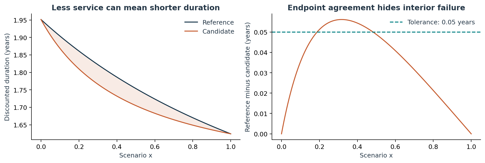
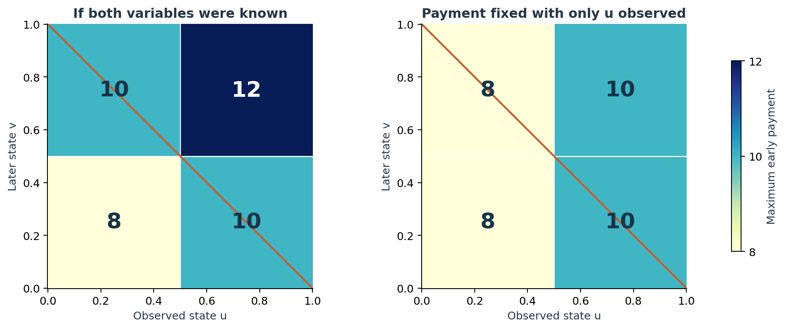

# When paying less still fails the test

**An exact study of state-contingent sovereign debt shows how payment timing, trigger information and the choice of comparability rule determine what can be promised.**

*Evidence Press · Research creator: Anonymous · 15 October 2026 · Unrefereed research*

Suppose a restructuring lowers every payment owed to one creditor. Has it necessarily delivered at least as much relief?

For the amount paid, yes. For discounted present value, yes when the same positive discount factors are used. For duration, not necessarily. Duration measures the average timing of the payments that remain. If a restructuring removes proportionally more value from later dates, the surviving stream can become earlier even though every individual payment is smaller.

That distinction is the starting point of this paper. It studies a deliberately declared screen with three separate requirements: enough present-value relief, enough relief during a programme period, and enough duration extension. It does **not** assert that this is the Paris Club's operative decision rule. The Paris Club's public methodology permits trade-offs and broader judgement. The mathematical question is narrower and exact: once a rule, contract, state space and information order have been declared, does the candidate pass in every reachable state?

## Why endpoint checks can be wrong

Consider two payment dates, one and three years away. In one state, a reference agreement pays 3 and 2 while a candidate pays 2.5 and 1.5. Both candidate payments are lower. Without discounting, the reference's average payment date is 1.8 years and the candidate's is 1.75 years. The candidate removes one sixth of the early payment but one quarter of the late payment, so its remaining value is concentrated earlier.

The paper embeds this effect in a continuous state variable. A simple construction passes the duration comparison at both endpoints but fails everywhere inside. A perturbation proves that this is not merely an equality artefact: for every parameter between 0 and 1/4, both endpoint margins are strictly positive while an interior interval still fails. The retained exact test uses the parameter 1/8.

*The plot illustrates the constructed continuum. The symbolic proof, not the pixels, establishes the all-state result.*

There is a general identity behind the example. Write the reference stream as the candidate stream plus the value removed. The candidate has longer duration precisely when the removed value had an earlier average date than the reference. It has shorter duration when the removed value was later. Proportional reductions preserve duration.

This leads to an exact rule diagnostic. If any componentwise reduction of an accepted stream must remain accepted, the required duration cannot exceed the earliest payment date that may remain. A higher duration threshold necessarily rejects some stream obtained only by reducing payments. This is a property of the acceptance rule, not a welfare judgement about which rule should be chosen.

## A payment cap is conditional on the rule

The first design example compares a reference paying 20 in year one and 50 in year three with a candidate paying `10 + p` in year one and 45 in year three. At a 5% accounting rate:

- present value alone permits `p = 6410/441`, about 14.535;
- the programme-service condition permits `p = 10`;
- the separate duration condition permits only `p = 8`.

At `p = 8`, the candidate pays 18 and 45, exactly 90% of the reference at both dates. Duration is therefore preserved under any common positive discount factors. Increasing only the early payment shifts the remaining stream forward and breaks the duration test.

The number 8 is sharp for this constructed contract and this declared screen. It is not a universal recommendation. A specified weighted score permits about 11.842 at 5%; allowing a duration shortfall of about 0.04564 years raises the separate-screen cap to 10. Exact arithmetic exposes the consequences of a rule, but it does not select the rule.

Earlier IMF work already discusses state-contingent instruments, caps, floors, indicator quality and the risk that large upside payments consume restructuring relief. The new contribution is the exact application-focused calculation once the contract and decision rule are fixed. [Cohen et al. (2020)](https://www.imf.org/-/media/files/publications/sdn/2020/english/sdnea2020006.pdf)

## Tomorrow's information cannot set today's payment

A second construction has two state variables, four dates and three interacting triggers. One variable is observed before the first payment; the other arrives later. Six trigger regions are reachable.

If both variables were known in advance, a statewise calculation would permit an early payment of 8, 10 or 12. But a payment fixed before the second variable is observed must be identical in states that look the same today. Its feasible interval is the intersection of the intervals for every compatible future state. The sharp implementable payment is therefore 8 or 10, depending only on the information already available.

*The information constraint is an intersection over indistinguishable states. No probabilities are assumed, so the difference is not an expected monetary value of information.*

This is a scalar specialisation of established adjustable robust optimisation, where decisions may depend only on observations available when they are made. The paper proves the interval result directly and credits the general framework to Ben-Tal and co-authors. [Ben-Tal et al. (2004)](https://www2.isye.gatech.edu/~nemirovs/MP_Elana_2004.pdf)

## An oblique trigger that genuinely changes the bound

The paper then removes three simplifying features of the first multi-trigger example. Old payment profiles are no longer matched, later payments are nonproportional, and an oblique trigger `u + v >= 1` changes the sharp limit.

The reference pays 20 in year one and 40 in year four, plus an uplift `lambda` in year six after the trigger. The candidate pays an adjustable amount `p` in year one, 20 in year three and 10 in year five. Accounting discounting is set to zero so the exact mechanism is visible.

Off-trigger, the three constraints give caps of 45, 25 and 50. Programme service binds, so `p <= 25`. On-trigger, the present-value and programme caps remain above the duration cap

`U_D(lambda) = (750 - 10 lambda) / (15 + lambda)`, for `0 <= lambda < 75`.

The duration cap crosses the programme cap 25 exactly at `lambda = 75/7`. At the retained value `lambda = 20`, the trigger-on cap is `110/7`, about 15.714. Because every observed early state remains compatible with a later trigger, the robust implementable ceiling is `110/7`. The oblique trigger lowers the cap by `65/7` and changes the metric that binds.

This family is still synthetic. Its value is that the substantive effect has a transparent closed form and cannot be dismissed as a compiler-only branch change.

## What has actually been verified

With fixed old claims, positive discount factors and affine new payments inside each trigger region, present-value and programme comparisons are affine. Clearing the positive duration denominators gives a quadratic inequality. On a bounded rational polytope, a quadratic minimum can be found exactly by examining every face and its stationary set. The manuscript proves this finite method, including singular stationary systems.

The release includes two implementations. The producer generates exact rational certificates. A separate low-dimensional checker imports neither the producer nor its optimiser: it rebuilds 16 declared domains and 10 trigger regions from the contract data, checks boundary ownership and reachability, and then verifies 48 exact minima, 252 coefficient-determining identities and the two scalar intervals in the new family. A deliberately self-consistent certificate with a shortened domain is rejected. Ordinary and optimised Python runs agree.

These checks are strong evidence about the declared implementation and examples. They are not formal proof-assistant verification, independent external reproduction, legal authentication or peer review. The universal claims stand on the written proofs in the manuscript.

## The boundary between mathematics and policy

The method can establish whether a fully specified contract satisfies a fully specified rule over a fully specified state space. It cannot establish that the data represent every signed instrument, that the rule captures an institution's judgement, that the residual debt is sustainable, or that one distribution of relief is socially preferable.

The World Bank recorded the Official Creditor Committee's confirmation that Zambia's March 2024 agreement met comparability requirements. This paper issues no contrary country verdict. A real audit would need complete authenticated instruments and the actual assessment rule. [World Bank statement](https://www.worldbank.org/en/news/statement/2024/03/26/world-bank-group-statement-on-debt-restructuring-agreement-for-afe-zambia)

The defensible contribution is an exact methods synthesis with new closed-form diagnostics and reproducible benchmarks. It shows where endpoint sampling fails, when payment dominance conflicts with duration, how information restricts contingent promises, and how an oblique trigger can switch the binding constraint. Its literature search is documented but not exhaustive, and priority for the exact constructions remains unresolved.

---

**Read the research:** [Full manuscript](../state-contingent-comparability-v3.pdf) · [Evidence and replay guide](../README.md) · [Structured claim map](../CLAIMS.json)

**Disclosure:** The research, code and presentation were AI-assisted. All numerical examples are constructed unless explicitly identified as a reconstruction of a public institutional illustration. Figures explain the results; exact proofs and certificates establish them.
